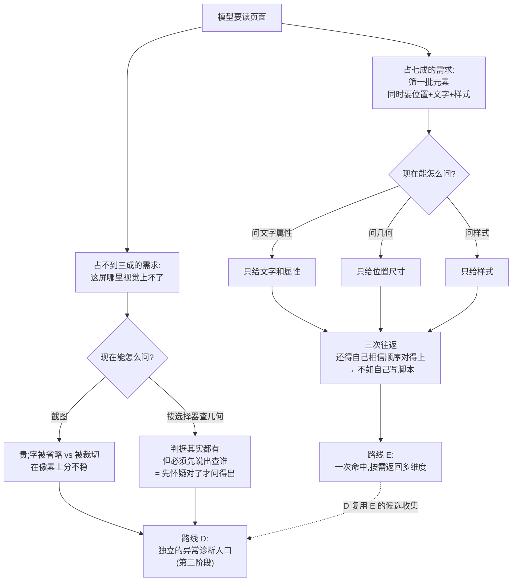

# 视觉异常自陈能力 — 实现思路

> 立项来源：2026-08-20 用户观察「调研 gamma 时看到大量截图」。日志核查后表象被推翻，
> 真问题另有其形。本文记录重定位过程与候选路线。

## -1. 一页纸

**改什么** —— 让模型问一次就能把一批元素的位置、文字、样式一起拿回来，
而不是问三次再自己拼；顺带补上「这一屏哪里被切掉、被压住」这类它现在
只能靠截图找的问题。

**为什么现在改** —— 实测一次真实调研（近两天四个会话，1502 次浏览器调用）里，
近半数调用是模型自己写脚本读页面。把这些脚本逐条分类后，**七成是在做同一件事**：
按条件筛出一批元素，然后同时要它们的位置、文字和样式。现有查询方式每次只给其中一样，
所以模型宁可自己写。剩下不到三成才是在找视觉异常，而这部分能力其实早就有，
只是必须先说出「查哪个」才用得上——于是也没人用。

**改完谁会感觉到什么不同** —— 让模型看页面的人（做界面借鉴、做还原度验证、
做视觉回归）会发现两件事：模型不再为了拿齐信息而反复写脚本；
以及它开始能直接说「第 3 张卡的正文被容器切掉了 34 像素」，而不是截图猜。

**本次明确不解决什么** —— 不做像素级视觉对比（两张图差异比对）；
不做美学判断；不替代截图——整体版式观感仍然要看图；
不做跨页面框架的元素关系（同一页里嵌套的独立文档之间，位置无法互相比较）。

**不改会怎样** —— 现状可用但昂贵且不可信：每次拿信息都要现写脚本，
每次都可能写错，写错了没人发现，因为没有第二个来源可以对账。
视觉判断则要么截图（占用大量上下文），要么同样自己算。

**影响面多大、风险在哪** —— 只增不改：现有查询方式行为不变，老调用继续按老样子工作。
风险集中在三处：一是**一次要多个维度后返回的数据量可能失控**，
必须有明确上限并在被截断时说出来，不能悄悄少给；
二是**「没检测到异常」不等于「确认没问题」**——扫描本身有覆盖范围和抽样局限，
这个边界必须写进输出，否则调用方会当成体检合格；
三是**同一页里嵌套的独立文档各算各的坐标**，跨文档的位置关系本次给不出，
输出里要讲清作用域，不能让人误以为已经全查过了。

## 0. 实现流程图

## 0.5 问题重定义

**表象与真正失效的机制不是一回事。** 用户看到的是「大量截图」；日志实测截图只占
6.1%（92/1502），真正的大头是模型自写脚本 47.3%（710/1502），其中 61.2% 在调
`getBoundingClientRect`、30.1% 在调 `getComputedStyle`。截图之所以显眼，是它在终端
里渲染成图片。**真正失效的不是截图太多，而是「发现式视觉提问」无法表达**，
截图与自写脚本都是这个缺口的投影。

**链路上每条约束逐条分类：**

| # | 约束 | 分类 | 依据 |
|---|------|------|------|
| 1 | 查几何必须先指定目标 | **历史习惯** | `schemas-public.ts:502` `required:["mode","pattern"]`；运行时另有 @ref 寻址链（`query.ts:1869` `resolveTargetOptional`），但 `query.ts:1886` 硬门 `if(!pattern) throw` 使两条链**都要求先知道查谁**。Luna 指出我漏了 @ref 这条链，结论不变 |
| 2 | 单次最多返回 50 个元素 | **历史习惯** | `packages/extension/src/handlers/query.ts:1968` `Math.min(?? 10, 50)`；geometry 每元素约 8 个标量字段，远轻于同族其他模式，50 是抄来的 |
| 3 | 元素间关系只算前两个 | **历史习惯** | `packages/extension/src/handlers/query.ts:723` `if (rects.length >= 2)` 只取 `rects[0]`/`rects[1]`；当初需求是「A 与 B 什么关系」 |
| 4 | 遮挡判断只测中心点 | **历史习惯**（原标「两者皆有」，Luna 指出表述过强，已订正） | `query.ts:660` 单点采样可改多点。「给不出遮挡面积比」**不是普遍物理不可能**，而是当前 DOM 命中测试探针不提供像素合成、透明度与多层绘制信息——换探测手段（如渲染层信息）可得，只是不在本次范围 |
| 5 | 裁剪只看最近一层溢出祖先，且只比矩形边界 | **历史习惯** | `query.ts:673` 循环体末尾无条件 `break`，多层嵌套裁剪漏判；且判据只做矩形比较，`clip-path` / mask / 非矩形裁剪 / 视觉变换全部不在覆盖内（Luna 补充）|
| 6 | 截图无法**稳定可量化地**区分「文字省略」与「布局裁切」 | **物理必然** | 原写「像素上长得一样」不严谨——省略号常是可见线索（Luna 订正）；成立的是「不可稳定量化」。反过来现有判据也只是 `scrollWidth>clientWidth`（`query.ts:669`），并不证明真出现了 ellipsis |
| 7 | 模型必须先怀疑才问得出问题 | **历史习惯** | 同仓已有反例：盲区自陈无需调用方指定目标，独立扫描后主动产出（`packages/extension/src/handlers/observe.ts:3808`） |
| 8 | **一次查询只能拿一个维度** | **历史习惯** | 三个模式各占一维且互斥：css 给文本/属性不给几何（`query.ts:172`）、geometry 给屏幕坐标不给文本/样式（`query.ts:580`）、style 给 computed 样式含 width/height 但无 left/top（`query.ts:991`）。而三者的元素集合语义本就相同——`queryAllDeep` 在同文件内联复制**四份**（`query.ts:188` css、`299` component、`615` geometry、`797` style），其中后三份逐字相同，`188` 多两个计数器供空结果诊断；三处注释写「改一处须同步」（`query.ts:183/280/578`） |

**反事实检验（原判断已被实测推翻，见 §6）：** 起初我断言「去掉约束 1 与 3，
那批批量捞坐标的脚本就会消失」。实测不支持：727 条自写脚本按互斥口径分类，
**做异常判定的占 26.7%（上界，含脚本外判定），纯取数与操作占 73.3%**。
放开选择器与 N 元素两两比较，那 73.3% 一条也不会少——它们要的不是异常判定，
而是「按条件筛一批元素，一次拿齐几何 + 文本 + 样式」。

**真正咬住主要负载的是约束 8。** 去掉维度互斥后，那批脚本里
79.1% 的元素筛选、60.7% 的批量遍历、32.1% 的样式同取，都能由一次查询完成。
约束 1 与 3 仍然是真约束，但它们咬住的是那 26.7%。

**本次修根因，但根因不止一条，且主次已由实测定序。** 主根因是约束 8
（维度互斥，咬住 73.3% 负载）；次根因是约束 1、3（提问语义错位，咬住 26.7%）。
约束 4 的探测手段局限不在本次范围，改为在输出中显式声明遮挡结论为抽样结论。

## 1. 目标与判据

**E（本次主体）**

1. 一次查询命中一批元素后，可按调用方请求同时返回几何、文本、属性、样式中的多个维度，
   元素身份在各维度间对齐（判据：同一元素在各维度下标一致，构造 shadow DOM 与嵌套用例验证）。
2. 上限语义单一：`maxResults` 只控制元素数（默认 20、上限 50），
   **不因所选维度而重新解释**——同一选择器选 `geometry` 与选 `geometry|font`
   必须返回同一批元素，否则调用方无法对齐（辩论第三轮定案，采纳 Luna）。
   任一维度不可用时**必须自陈**，不得静默少给：返回顶层
   `dimensions.<name>.available=false` + `reason`，元素级同时带
   `evidence="unavailable"`（判据：构造 CDP 失败与超限两类用例，
   断言字段存在且为 unavailable，而非字段消失）。
3. 维度级错误隔离：选择器非法是整请求错误；单个元素的样式/伪元素/几何采集失败
   不得让其他维度一起丢（判据：构造单元素抛错用例，断言其余元素与其余维度仍有值）。
4. 单维度调用的返回结构与现状保持一致。**判据不能只写「现有测试全绿」**——
   实查表明现有测试字段值覆盖密（`query-style.test.ts` 95 个断言）但形状覆盖稀
   （整体形状断言 1~11 个），且 `showing` 在 geometry/css/style 三个专项测试中
   **零覆盖**，仅 `query-handler.test.ts` 断言 6 次。
   故判据为：**先补形状级断言锁住四种老返回形状（补完应全绿），再改实现（必须仍绿）**。
5. 元素集合构造不再新增内联副本（判据：`queryAllDeep` 在 `query.ts` 中的定义处计数
   不高于现状 4 处；具体收敛到几处取决于 §4 的 P1 定案）。

**D（第二阶段，本次只定边界不实现）**

5. 不指定目标即可提出视觉异常问题，返回被裁切、被遮挡、互相重叠的元素清单及数值证据。
6. 输出可区分「未扫描/被截断」「未发现异常」「确认无异常」三态；
   遮挡结论标注为抽样结论。

## 2. 现状勘察

**几何探测已经存在，且能力比预想的多。** `packages/extension/src/handlers/query.ts:580`
`geometryProbeFunc` 已实现 `clippedByAncestor`（布局裁剪）、`occluded` + `occludedBy`
（遮挡及遮挡者）、`textClipped`（文字省略）、`inViewport` 与 `pair.overlap`；
函数头注释（`query.ts:571-577`）明确写了它的立意就是「回答看似视觉、实可几何化的布局问题」。

**但它是「核实」语义，不是「发现」语义。** 入口要求 pattern 必填
（`packages/mcp/src/tools/schemas-public.ts:502`），意味着调用方得先怀疑对了才问得出；
上限硬钳 50（`query.ts:1968`），扫一屏不够用。

**关系判断只覆盖两个元素。** `query.ts:723` 起的 `if (rects.length >= 2)` 分支
只读 `rects[0]` 与 `rects[1]`，产出单个 `pair` 对象；命中 20 个卡片时，
其余 18 个之间的关系无从得知。

**这项能力对模型基本不可发现。** 工具清单里该模式的全部描述是
`geometry=bbox/clip/occlude`（`packages/mcp/src/tools/schemas-public.ts:477`），
`overlap`、`pair`、六类对齐判断一个字未提。实测印证：近两天四个会话
1502 次调用中，查询工具共 3 次，geometry 模式 0 次。

**三个查询模式各占一个维度，互斥。** css 返回 tag/text/attrs/children_count，
无几何无样式（`query.ts:172` 返回体类型）；geometry 返回含 left/top 的坐标与四类判据，
无文本无属性无样式（`query.ts:580`）；style 的 box 组含 computed `width`/`height`
但没有屏幕坐标（`query.ts:991`），无法据此判断位置或重叠。

**而三者的元素集合语义本就相同。** `queryAllDeep` 在同一文件内被内联复制**四份**：
`query.ts:299`（component）、`615`（geometry）、`797`（style）三份**逐字相同**，
`query.ts:188`（css）多出 `scannedElements` 与 `shadowRootsSeen` 两个计数器供空结果诊断。
三处注释写明「改一处须同步」（`query.ts:183`、`280`、`578`）。
组合不是新增语义，是把已经重复四遍的东西收敛成一次。

**注意 text 模式不在此列。** `query.ts:40-62` 走的是 `collectRoot` + TreeWalker
遍历文本节点（带 `SKIP_TEXT_TAGS` 与 `checkVisibility` 的可见性契约），
与按选择器命中元素是不同语义，不可并入（此处我先前误记为「第五份副本」，
实查订正，见 §6）。

**可复用的既有机制：盲区自陈是同仓现成的「推式」先例。**
`packages/extension/src/handlers/observe.ts:3808` 在元素收集之外**独立扫一遍 frame**，
产出 frame 级条目并渲染成 meta 行，全程不需要调用方指定目标；
字段定义见 `observe.ts:217-218`（元素级）与 `observe.ts:236-237`（frame 级）。
视觉异常自陈可直接套用这套形状。

**硬约束清单：**
- page-side 探测函数注入后丢失模块作用域，工具函数必须内联（`query.ts:578` 注释已标注）
- 盲区检测采用「真源纯函数 + 探针内联副本」双写，改一处须改两处
  （`observe.ts:3500-3501`、`observe.ts:3838`），套用该模式会继承此维护成本
- jsdom 对布局零支持（`getBoundingClientRect` 恒返回 0），几何判据的单测必须
  避开「靠 jsdom 算布局」，否则必然假绿

## 3. 候选路线

> 路线 E 与 D 是与 Luna（`poke/gpt-5.6-luna`）两轮辩论后新增的。
> A/B/C 三条写于实测负载分类之前，保留以便核对取舍过程。

### 路线 E — 让查询模式可组合（覆盖主要负载）

**业务上的差别：** 模型问一次「把这批元素的位置、文字、样式都给我」，
就能拿齐；现在得问三次，还得自己相信三次的元素顺序是对得上的。
这是唯一一条正面对着 73.3% 实际负载的路线。

- **切入点**：统一元素集合构造 + 按需维度采集，落在 `query.ts` 三个探针
  （`query.ts:172` css / `query.ts:580` geometry / `query.ts:991` style 的 box 组）
- **改动落在哪一层**：查询工具层，但改的是模式之间的关系，不是某个模式内部
- **为什么行得通**：三个模式本就针对同一元素集合，`queryAllDeep` 已被内联复制四份
  （`query.ts:188/299/615/797`，后三份逐字相同）；组合不是新增语义，
  是把已经重复四遍的东西收敛成一次
- **代价**：探针内的判据目前嵌在各自函数体里，不是可复用单元；要在
  「注入丢模块作用域、必须自包含」（`query.ts:578` 注释）的约束下抽共享单元。
  返回体变大，各维度需要独立上限与截断自陈
- **什么条件下会失效**：如果实际调用几乎总是只要一个维度，组合就是白做——
  实测反驳了这点（32.1% 的纯取数脚本同时取样式），但样本仅四个会话，列入 §7

### 路线 D — 独立的视觉异常诊断入口（Luna 提出）

**业务上的差别：** 多一个「帮我看看这页哪里不对」的入口，不用先说查谁。
和 E 面向的是完全不同的问题：E 是「我知道查谁，要拿全」，D 是「我不知道查谁」。

- **切入点**：MCP 工具层新增独立入口，内部做受限候选提取 + 复用几何判据
- **改动落在哪一层**：工具语义层（新增产品概念），不改现有查询也不改观察
- **为什么行得通**：可在工具层统一处理截断、frame 作用域、
  「未检测到 ≠ 确认无异常」的状态表达——这些放在 A 或 B 里都无处安放
- **代价**：新增一个对外概念，长期要维护；判据必须复用页面内探针
  （`query.ts:580-745`），不能在工具层拿 bbox 重算，否则重复实现浏览器语义
- **什么条件下会失效**：候选提取漏掉真异常元素时，输出「未发现异常」
  比不输出更有害

### 路线 A — 放开现有几何查询（拉式加强）

**业务上的差别：** 模型仍要主动发问，但可以问得很宽。上线最快，对现有调用零影响。

- **切入点**：`query.ts:580` 探针 + `query.ts:1965` 分派 + `schemas-public.ts:477/502` 契约
- **为什么行得通**：三条卡住的约束全是历史习惯，判据已实现，只需放开范围
- **代价**：只覆盖 26.7% 的负载；模型仍需先想到要问；
  关系判断现为单个 `pair` 对象（`query.ts:723`），改数组即改契约
- **什么条件下会失效**：模型压根没意识到该问——这正是当前 0 次调用的成因

### 路线 B — 观察页面时自动附带视觉异常（推式自陈）

**业务上的差别：** 每次看页面自动带一行异常提示，模型不需要先怀疑。
代价是最高频的调用变慢、变长，且多数页面这行是白付出。

- **切入点**：`observe.ts:3808` 既有 frame 级独立扫描
- **代价**：继承观察的元素上限与时间预算（`observe.ts:4068-4073`），
  「未发现」可能只是没扫到；继承双写维护成本（`observe.ts:3500-3501`）
- **什么条件下会失效**：滤规则把真异常挡掉——输出「未发现异常」会被当成确认

### 路线 C — A 打底 + B 只报高置信信号

按判据自足性切分：单元素能独立判定的进默认输出，需跨元素比较或空间采样的留按需查询。
详见 §4 为何在实测后被降级。

## 4. 取舍与选定

**待用户在关卡确认。以下是两轮辩论后的收敛结论——我与 Luna 独立起判、
在实测证据下双双改判到同一条路线。**

推荐 **先 E，D 作为第二阶段**；A 的有效部分并入 E，B 与 C 不单独立项。

**放弃「C 作为主路线」（我与 Luna 第一轮的共同初判），因为**：C 瞄准的是异常检测，
而实测互斥口径下异常检测只占 26.7%（上界，已含脚本外判定），
取数与操作占 73.3%。第一轮双方都在没有负载分类数据的情况下，
把文档里描述的问题当成了主要问题。

**放弃路线 A 单独成案，因为**：它把「模型没想到要问」原样留在原地。
现状该模式早已具备 clip/occlude 判据（`query.ts:580`）却是 0 次/1502 次调用——
**「加强能力 + 改描述文字」这条路已经失败过一次**。A 的有效改动
（选择器可选、上限重定、关系扩为 N 元素）并入 E 与 D 中落地。

**放弃路线 B，因为**：观察是最高频调用，而 B 中真正昂贵的两类判据恰恰最不可靠——
遮挡靠单点采样（`query.ts:660`），重叠是 O(n²)。更硬的一条是 Luna 指出的漏扫：
新信号只覆盖已收集元素，会继承元素上限与时间预算（`observe.ts:4068-4073`），
正常页面也可能返回「未发现」而实际根本没扫到。

**为什么 E 先于 D**：E 覆盖 73.3% 的实测负载，D 覆盖 26.7%；
且 D 需要复用 E 的候选收集与维度采集，反过来不成立。先做 D 会导致
候选提取逻辑写两遍。

**E 与 D 是互补不是竞争**：E 解决「知道查谁但拿不全」，
D 解决「不知道查谁」。两者都做才完整，但顺序由负载占比与依赖方向共同决定。

### E 的实现形态（辩论第三、四轮定案）

**选定：老 mode 在 handler 层翻译成维度请求，转发到同一个原始探针，
再由纯函数整形层还原成各自原有的返回形状。** 债从四份内联遍历降为
一份原始探针 + 四个契约适配器。

**放弃「纯新增组合探针、老 mode 不动」，因为**：它让内联副本从四份变五份，
与收敛目标直接冲突；Luna 第二轮已立场明确「不应绕开它继续增加第六份逻辑」，
选此案等于自我推翻。

**放弃「把 query 探针整体迁到 page-side bundle 机制」，因为**：仓库存在两套
互不相通的注入机制——`executeScript({func})` 序列化传函数、丢模块作用域
（`query.ts:578` 注释：「⚠ 自包含:注入丢模块作用域,queryAllDeep 必须内联」），
`executeScript({files})` 走 vite IIFE bundle、本地 import 被 inline
（`page-side/index.ts:2-4`、`page-side/actionability.ts:8`）。迁移可真正共享，
但要继承 `adapter/page-side-loader.ts:24-35` 记录的 in-flight wedge 事故风险
（原注释：「observe 走 executeScript({func}) 无此缓存故始终正常，
dom.* 经 loadPageSideModule 则全挂，且仅 SW 重启才恢复」），
且 query 其余六个 mode 要么跟着迁要么两套并存。代价明显大于收益。

**因此 Luna 第三轮提的「老 mode 内部替换为共享 primitive
（`page-side/shadow-walk.ts:32-51`）」不成立**——在 `{func}` 机制下 import
会在运行时抛 `queryAllDeep is not defined`。第四轮它接受此事实并改选转发。

### 实施前置：测试先补形状，不能直接改实现

现有测试**不足以锁住四种老返回形状**，实查（双方各自独立查证，结论一致）：

| 测试 | expect 数 | 整体形状断言 | 断言 `showing` |
|---|---|---|---|
| `query-geometry.test.ts` | 17 | 1 | **0** |
| `query-handler.test.ts` | 34 | 2 | 6 |
| `query-css-attr-normalize.test.ts` | 9 | 6 | 0 |
| `query-style.test.ts` | 95 | 11 | 0 |

更硬的一条是 Luna 查到、我未查到的：**`query-handler.test.ts` 的 css 测试
mock 掉了 `executeScript`**（`tests/query-handler.test.ts:105`），探针根本没跑，
测的只是 handler 透传；且该文件没有 geometry/style 的返回形状测试。

**但 Luna 给的变异验证本身是错的**（我实查反驳）：它建议「把整形层 `showing`
改成 `elements.length - 1`，断言 `query-handler.test.ts:104-125` 必须转红」。
实查该用例（`tests/query-handler.test.ts:104-125`）只断言 `result.total === 2`
与 `result.elements` 长度为 2，**mock payload 里虽有 `showing: 2` 却从不断言它**——
改 `showing` 不会让任何测试转红。这恰恰是缺口本身，不是验证手段。

**故实施顺序固定为**：先补形状级断言（含 `showing`、css 零命中的 `scanned` 自陈）→
用变异验证证明这些**新补的测试**确实会转红 → 才动实现 → 老测试与新测试同时保持绿。

## 5. 改动地图

**阶段一（E）**

| 位置 | 改动 |
|------|------|
| `packages/extension/src/handlers/query.ts:188/299/615/797` | 四份 `queryAllDeep` 内联副本收敛为单一共享实现（`188` 的两个诊断计数器须保留）；注释「改一处须同步」（`query.ts:183/280/578`）随之作废。text 模式的 `collectRoot`（`query.ts:40-62`）语义不同，不并入 |
| `query.ts:172` cssQueryFunc / `query.ts:580` geometryProbeFunc / `query.ts:991` style box 组 | 判据与采集从各自函数体中抽为可复用单元，仍满足「注入丢模块作用域须自包含」（`query.ts:578`） |
| `query.ts:1965` 分派 | 一次构造元素集合、按请求维度采集；各维度独立上限与截断自陈 |
| `packages/mcp/src/tools/schemas-public.ts:477/482` | 新增维度组合参数；工具描述补可发现面 |
| `packages/extension/tests/query-*.test.ts` | 单维度回归 + 组合形态新用例 |

**阶段二（D，本次不实现）**

| 位置 | 改动 |
|------|------|
| `packages/mcp` 工具层 | 新增独立诊断入口，`scope`/`checks` 参数，不要求指定目标 |
| 复用阶段一产出 | 候选收集与几何判据复用 E 的共享单元，不在工具层拿坐标重算 |

**数据怎么流**：页面内一次命中元素集合 → 按需采集各维度 → 结构化结果。
D 复用同一条链，只在前面加一层候选提取。两阶段共用同一批判据，
不产生第二份实现。

## 6. 被证伪的直觉

**「vortex 缺少视觉正确性的工具级答案」——错。** 这是我在日志分析后给用户的初判。
勘察发现 `query.ts:580` 早已实现裁切、遮挡、文字省略、重叠四类判据，
函数头注释（`query.ts:571-577`）写明立意正是替代截图目视。
证伪后问题从「补能力」重定位为「能力可达性」，候选路线随之整体改写。

**「模型不用几何查询是因为工具描述没写清楚」——不完全成立。** 描述里确实
有 `clip/occlude` 字样（`schemas-public.ts:477`），并非完全不可见。
真正拦住的是入口要求先指定目标（`schemas-public.ts:502`）——
描述写得再好也解决不了「得先猜对才问得出」。故未把「改描述」列为独立路线。

**「截图多是缺陷」——错。** 抽样截图后的模型判断，内容是
「顶部标记整个不见了，标题第一行被切掉」「四个条目不再重叠、不再出卡」，
属整屏视觉正确性验证。92 次占比 6.1%，用途正当，不在本次改动范围。

**「异常检测是主要需求」——错，且我与 Luna 第一轮都栽在这里。** 双方独立起判、
独立选中同一条路线（C），理由也高度重合。把 727 条自写脚本按互斥口径分类后，
异常检测占 26.7%（上界，含脚本外判定）、取数与操作占 73.3%——
**第一轮双方是在同一份缺少负载分类的材料上达成的一致，一致本身没有증明力。**
这也推翻了本文原 §0.5 的反事实检验（原断言：去掉选择器必填与两元素限制后，
那批批量捞坐标的脚本会消失）。

**「@ref 已经构成无目标扫描的既有支持」——错（Luna 提出，经核实后由我反驳，Luna 终审维持我的结论）。**
运行时确有 @ref 寻址链（`query.ts:1869` `resolveTargetOptional`），
但 `query.ts:1886` 是硬门 `if (!pattern) throw`，@ref 反查出的仍是指向已知元素的选择器。
两条链都要求先知道查谁。我的原表述漏了 @ref 这条链，结论不变。

**「`queryAllDeep` 有五份内联副本」——错，是四份，且这个错经历了一次虚假的双重确认。**
实查（`query.ts:40-62`/`188`/`299`/`615`/`797`）：text 模式走的是 `collectRoot` + TreeWalker
遍历文本节点，带 `SKIP_TEXT_TAGS` 与 `checkVisibility` 可见性契约，与按选择器命中元素
不是同一件事，不该计入。真实为四份，其中 `299`/`615`/`797` 逐字相同，
`188` 多 `scannedElements` 与 `shadowRootsSeen` 两个计数器。

**教训比这个数字本身重要**：我在第二轮的证据文件里写下未经核实的「五份」，
Luna 直接引用它作为论据（`reports/_review/luna-visual-query-r2.md`），
于是这个错误在两个独立判断者之间获得了看似互相印证的地位。
第三轮我明确要求它「实际读源码，不许凭前两轮转述」，双方各自实查后同时得到四份。
**辩论不能校验双方共享的前提——只有实查能。**

## 7. 待验证假设

| # | 假设 | 现状 | 谁确认、怎么确认 |
|---|------|------|-----------------|
| 1 | 放开上限后单次返回体不会超出可接受大小 | **推断**（按每元素约 8 个标量字段估算） | 实施者：在真实复杂页面（gamma 编辑器）实测 n=200 时的返回字节数 |
| 2 | 两两重叠 O(n²) 在 n≤200 时耗时可接受 | **推断** | 实施者：同上页面实测耗时，与现有 geometry 调用耗时对比 |
| 3 | 真实场景的主要异常类型是裁切而非重叠 | **未验证**，直接决定路线 C 的 B 半部分是否抓住重点 | 实施者：拿本次日志中那批自写几何脚本，统计它们各自在判定什么 |
| 4 | 多点采样能显著降低遮挡漏判 | **未验证** | 实施者：构造部分遮挡用例（仅压住一角），对比单点与多点结论 |
| 5 | 观察路径新增扫描不会拖慢高频调用 | **推断** | 实施者：观察调用加扫描前后耗时对比，需在同一页面同一状态下测 |
| 6 | jsdom 下几何判据无法真测，须另找验证手段 | **已确认为事实**（jsdom `getBoundingClientRect` 恒 0） | 已定：判据抽为纯函数喂构造 rect，接线正确性靠真实浏览器验证 |
| 7 | `textClipped` 误报率可接受 | **未验证，且会推翻推式那半**（Luna 提出）。判据只是 `scrollWidth > clientWidth`（`query.ts:669`），横向滚动容器、非文本内容都会命中 | 实施者：在真实页面统计该判据命中数与人工确认数之比 |
| 8 | 观察路径的候选集能覆盖真实异常元素 | **未验证**（Luna 提出）。新信号若只覆盖已收集元素，会继承元素上限与时间预算（`observe.ts:4068-4073`），「未发现」可能只是没扫到 | 实施者：构造已知异常元素，验证其是否进入候选集 |
| 9 | 改返回形状不破坏既有调用方 | **未验证**（Luna 提出）。关系判断现为单个 `pair` 对象（`query.ts:723`），改数组即改契约 | 实施者：MCP schema + 运行时参数校验 + 旧形态调用三处一起验，不能只跑 geometry 单测 |
| 10 | 跨 frame 的元素关系 | **已知不可得**（Luna 提出）。几何探测只对单个 frame 执行（`query.ts:1970-1974`），跨 iframe 的两两关系拿不到 | 已定：本次不做跨 frame 关系，须在输出中显式声明作用域 |
| 12 | 组合查询确有需求，而非几乎总是只要一个维度 | **部分实测**：321 条纯取数脚本中 32.1% 同时取 computedStyle、60.7% 批量遍历、79.1% 用 querySelectorAll 筛。但样本仅四个会话一类任务 | 实施者：上线后按维度组合统计实际调用分布 |
| 13 | 分母只取含坐标 API 的脚本会低估异常检测（Luna 提出） | **已补测，不翻盘**：以全部 727 条 evaluate 为分母的互斥口径，异常检测 26.7%（含脚本外判定 21 条）、取数与操作 73.3%，与原分类一致 | 已确认 |
| 11 | 「批量取数占多数」的分类法无系统性偏差 | **已自查，偏差有界**：分类按脚本内是否出现判定性 API，会漏掉「脚本只取数、模型拿回后自行判定」的情况。实测 324 条纯取数脚本中，其后模型文本谈及视觉异常的仅 21 条（6.5%）；**即便全部计入，异常检测占比上限 32.4%**，批量取数仍 ≥67% | 已确认，结论稳健 |

## 8. 辩论与评审记录

与 Luna（opencode `poke/gpt-5.6-luna`）四轮辩论。原始输出归档于
`reports/_review/luna-visual-query-r1.md` 至 `r4.md`。

**第一轮（独立起判，剥离我的取舍段避免锚定）**：Luna 独立选中 C，与我初判一致。
它另提出第四条路线 D（独立诊断入口），并指出 9 处遗漏，其中 6 处我直接采纳并已落进
§0.5 与 §7：遮挡「物理必然」表述过强、裁剪判据漏 clip-path/mask/非矩形、
「像素上长得一样」不严谨、观察层漏扫风险、跨 frame 语义、
缺 `textClipped` 误报率与候选集覆盖率两条假设。

**我的一处反驳（Luna 终审维持我的结论）**：它称运行时已支持无 selector 扫描。
核实 `query.ts:1858-1890` 后指出 `1886` 行硬门 `if(!pattern) throw` 使 @ref 与
显式选择器两条链都要求先知道目标。Luna 终审确认「1886 行之外没有可公开调用的
省略目标路径」。我的原表述漏了 @ref 这条链，这点它是对的。

**第二轮（我补入负载分类实测）**：双方同时改判——我从质疑 C 转向新路线 E，
Luna 独立改判为「E 优先、D 第二阶段」，理由与我一致（E 覆盖 73.3%、
D 覆盖 26.7%，且 D 依赖 E 的候选收集而非反之）。

**Luna 对我的数据提出五条偏差质疑**，其中「分母只取含坐标 API 的脚本」一条
我补测后写入 §7 第 13 行（互斥口径 26.7% vs 73.3%，不翻盘）；
「判定时点偏差」我在第二轮前已自查（§7 第 11 行，上界 32.4%）；
其余三条（API 代理偏差、多重命中致分类和超 100%、四会话样本外推）
均成立，已在 §7 第 12 行记为样本局限。

**第三轮（只辩 E 的设计）**：我给出四个自查问题（新增 vs 转发、四份副本是否等价、
上限策略、CDP 对齐失败的降级）。Luna 的 P2/P3/P4 定案我全部采纳：
四份可合 text 不并入、固定 20/50 且 `maxResults` 不按维度重解释、
font 不可静默缺失须带 `available:false` + `reason`。它另提六条我没想到的边界，
其中「组合模式若只返回每元素 geometry 会悄然丢掉 `pair`」与
「元素身份不能依赖数组 index」两条直接改写了 §1 判据。

**第三轮的一处虚假双重确认（我的错，见 §6）**：我在第二轮证据里写了未经核实的
「`queryAllDeep` 五份副本」，Luna 引用它作论据。第三轮我要求双方各自实查源码，
同时得出四份、且 text 不是副本。

**第四轮（收敛 P1）**：我实查两套注入机制后指出 Luna 第三轮的
「老 mode 内部替换为共享 primitive」在 `{func}` 机制下不可行，
给出 (a)/(b)/(c) 三个可行选项。Luna 改选 (b)，与我独立定案一致。
它同时查到两件我漏了的：handler 的 css 测试 mock 掉了 `executeScript` 探针没跑、
该文件缺 geometry/style 返回形状测试。

**我的第二处实测反驳（Luna 此轮给的变异验证无效）**：它建议改 `showing`
并断言 `query-handler.test.ts:104-125` 转红。实查该用例只断言 `total`
与 `elements` 长度，mock payload 里的 `showing` 从不被断言——改它不会让任何测试转红。
这是缺口本身而非验证手段。已据此把实施顺序固定为「先补测试→变异验证证明新测试有效→再改实现」。

**方法论账**：第一轮双方独立到达同一结论，但**一致是假的**——
双方读的是同一份缺少负载分类的材料。真正翻盘的不是辩论，
是把 727 条真实调用逐条分类。辩论的价值在于 Luna 提供了我没想到的 D，
以及六条我确实漏掉的技术边界；但**选型的决定性证据来自实测，不来自互相说服**。
